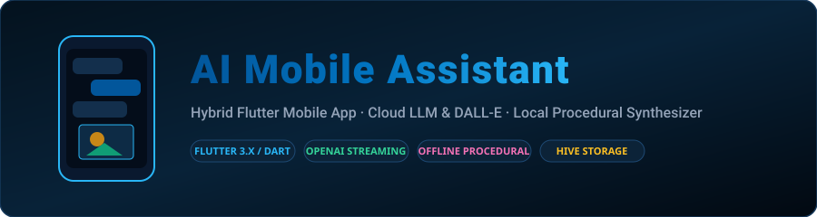
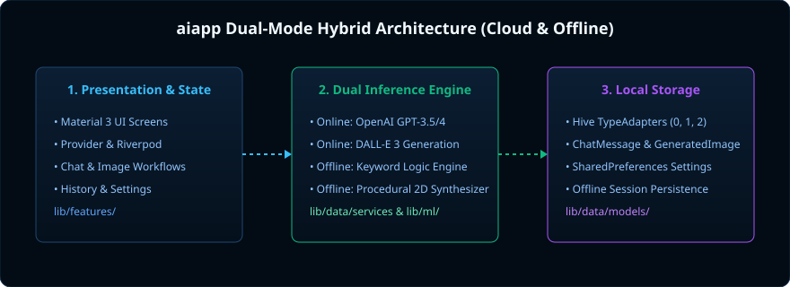

<div align="center">



# AI Mobile Assistant App

**A cross-platform Flutter application featuring dual-mode AI interactions: cloud LLM streaming with OpenAI alongside offline rule-based reasoning and procedural 2D image synthesis.**

[](https://github.com/kamalesh404/aiapp/actions/workflows/flutter-ci.yml)
[](https://flutter.dev/)
[](https://dart.dev/)
[](https://riverpod.dev/)
[](https://docs.hivedb.dev/)
[](LICENSE)

[Dual-Mode Architecture](#-dual-mode-architecture-online-vs-offline) · [Installation](#-installation--setup) · [Project Structure](#-project-structure) · [Testing & CI](#-testing--ci)

</div>

---

## 📖 Overview

**AI Mobile Assistant** is an architectural exploration of hybrid mobile AI workflows in Flutter. It demonstrates how modern mobile applications can bridge cloud-hosted artificial intelligence (OpenAI GPT-3.5/4 and DALL-E 3) with resilient, zero-connectivity local fallbacks.

When connected to the internet and provided with an API key, the app streams real-time conversational responses and high-fidelity generative imagery. When offline or unconfigured, the application gracefully shifts into standalone mode—providing rule-based conversational utilities and local procedural 2D canvas synthesis without crashing or blocking the user experience.

---

## 🔄 Dual-Mode Architecture: Online vs Offline

| Capability | Online Mode (Cloud API) | Offline Mode (Local Fallback) |
|---|---|---|
| **Conversational Engine** | OpenAI GPT-3.5 Turbo / GPT-4 streaming completion via HTTP | Deterministic keyword-matching reasoning engine with local intent routing |
| **Image Generation** | DALL-E 3 high-resolution image generation (1024×1024) | High-speed procedural 2D pattern synthesis (geometric, abstract, wave patterns) via Dart `image` package |
| **Data Persistence** | Hive NoSQL database persisting conversations & remote asset links | Local Hive boxes storing message history and locally synthesized PNG binaries |
| **Network Dependency** | Active Internet connection + valid OpenAI API Key | 100% offline; zero network calls or server dependencies |

---

## 🏗️ Architecture & Project Structure

The project adheres to Clean Architecture principles separating UI presentation, domain business rules, and external data services:

```
aiapp/
├── .github/workflows/
│   └── flutter-ci.yml          # GitHub Actions CI: Flutter setup, analyze & unit tests
├── assets/                     # Application icons, configuration schemas, and assets
├── docs/assets/                # Project architectural diagrams and banners
├── lib/
│   ├── core/
│   │   ├── config/api_config.dart # Endpoint and runtime API key configuration
│   │   ├── network/http_client.dart # Dio and HTTP network clients with timeout handling
│   │   └── themes/app_theme.dart    # Material 3 dark/light palettes
│   ├── data/
│   │   ├── models/             # Hive TypeAdapters (ChatMessage, GeneratedImage)
│   │   ├── repositories/       # Chat and image repository implementations
│   │   └── services/openai_service.dart # OpenAI chat and DALL-E integration
│   ├── domain/                 # Domain entities and use-cases
│   ├── features/               # Feature screens (chat, image gen, history, settings)
│   ├── ml/models/              # Offline keyword handlers and procedural 2D synthesizer
│   └── navigation/             # App routing and bottom navigation bar
├── test/
│   ├── models_and_config_test.dart # Unit tests for models and configuration
│   └── widget_test.dart        # Widget integration tests
├── pubspec.yaml                # Pinned Flutter dependencies
└── .env.example                # Template for external API keys
```

<div align="center">
  
</div>

---

## 🚀 Installation & Setup

### Prerequisites
- **Flutter SDK:** Version `>=3.0.0 <4.0.0`
- **Dart SDK:** Version `>=3.0.0`
- **Android Studio** or **VS Code** with Flutter extensions

### Setup Instructions

1. **Clone the repository:**
   ```bash
   git clone https://github.com/kamalesh404/aiapp.git
   cd aiapp
   ```

2. **Install Flutter packages:**
   ```bash
   flutter pub get
   ```

3. **Configure API Credentials (Optional):**
   To enable online OpenAI chat and DALL-E generation, copy the template and insert your OpenAI API key:
   ```bash
   cp .env.example .env
   ```
   > *Security Note:* The `.env` file is excluded in `.gitignore` and should never be committed to source control.

4. **Launch the application:**
   ```bash
   flutter run
   ```

---

## 🧪 Testing & CI

Unit tests validate data serialization, timestamp parsing, endpoint builders, and runtime configuration switches.

Run unit tests locally:
```bash
flutter test test/models_and_config_test.dart
```

Run static analysis:
```bash
flutter analyze
```

---

## 📄 License

This project is licensed under the [MIT License](LICENSE).
